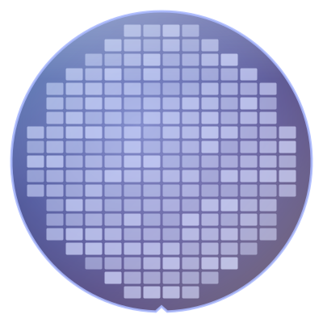
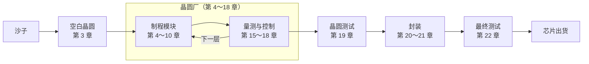

# 半导体制造概论

**跟着一片晶圆，走完从沙子到芯片的旅程**

**简体中文版** ｜ [总览首页](../README.md)

---

## 这本书在讲什么

一颗指甲大小的芯片上，有数十亿个晶体管。它们全部是在一片薄薄的硅晶圆上，经过数百到上千个步骤、花上好几个月「做」出来的。

这本书会跟着**一片晶圆**，从沙子开始，一站一站走进晶圆厂，经过微影、薄膜、蚀刻、布植、研磨与金属化，再到测试、封装，最后变成可以装进手机和电脑的芯片。

书里不谈艰深的物理和公式，而是专注在三件事：

- **流程**：每一步在做什么，为什么要这样做，顺序为什么这样排。
- **名词**：中英对照，以及在晶圆厂里实际怎么使用这些词。
- **Know-how**：教科书不太写、但在现场一定会遇到的事。

## 适合谁读

- 想知道芯片怎么做出来的理工背景读者，例如软件、固件、电机工程师与学生。
- 准备进入半导体业的新人，想先熟悉制造流程和现场用语。
- 已经在半导体业工作，但只熟悉自己负责的那一段，想看看全貌的人。

不需要半导体物理或化学背景，高中程度的理化知识就足够了。

## 每一章都有的三个小帮手

| 标示 | 内容 |
|---|---|
| 📍 晶圆位置 | 晶圆现在走到旅程的哪一站，前一站和下一站是什么 |
| 📖 名词框 | 定义、现场用法、相关名词，以及最容易搞混的地方 |
| 🔧 Know-how 框 | 现场的做法，以及「为什么要这样做、没做会怎样」 |

例如第 4 章微影里的一个 Know-how 框：

> [!TIP]
> **🔧 Know-how｜微影是「可以重来」的最后机会**
>
> - **情境**：检查发现图形尺寸或对准不合格。
> - **做法**：把光阻全部去掉，重新涂布、曝光，这叫 **Rework**。
> - **为什么**：这时晶圆上只多了一层光阻，底下的材料还没被动过。
> - **没做会怎样**：一旦进入蚀刻，错误的图形就会永久刻进材料里，晶圆可能只能报废。

---

## 全书地图

晶圆在晶圆厂里，会反复经过「铺材料、微影、蚀刻或布植、清洗、量测」的循环，一层一层往上盖。第 11～14 章把这些模块串成完整的流程，第 23、24 章则从系统和固件的角度，重新看一次整趟旅程。

---

## 目录

### 第 0 部　开始之前

| 章节 | 你会读到 |
|---|---|
| [第 0 章　半导体制造全景](0-before-you-start/00-overview/README.md) | 一颗芯片从设计到出货的旅程，以及产业如何分工 |
| [第 1 章　晶圆厂如何运作](0-before-you-start/01-how-a-fab-works/README.md) | 无尘室、自动搬运、机台、厂务，以及工厂里的各种职务 |

### 第 1 部　基础

| 章节 | 你会读到 |
|---|---|
| [第 2 章　从物理到晶体管](1-fundamentals/02-transistor-basics/README.md) | 半导体、掺杂、MOSFET 与 CMOS，只讲制程需要的程度 |
| [第 3 章　从沙子到晶圆](1-fundamentals/03-sand-to-wafer/README.md) | 纯化、长晶、切片与抛光，做出一片完美的空白晶圆 |

### 第 2 部　制程模块

| 章节 | 你会读到 |
|---|---|
| [第 4 章　微影](2-process-modules/04-lithography/README.md) | 光罩、光阻与曝光机，把电路图「印」到晶圆上 |
| [第 5 章　薄膜](2-process-modules/05-thin-films/README.md) | 热氧化、CVD、PVD、ALD 与磊晶 |
| [第 6 章　蚀刻](2-process-modules/06-etching/README.md) | 干蚀刻与湿蚀刻、电浆、选择比与终点侦测 |
| [第 7 章　离子布植与热处理](2-process-modules/07-ion-implantation/README.md) | 剂量、能量、退火与热预算 |
| [第 8 章　CMP](2-process-modules/08-cmp/README.md) | 把晶圆磨平：研磨液、碟化、侵蚀与假图形 |
| [第 9 章　清洗与污染控制](2-process-modules/09-cleaning/README.md) | RCA 清洗、Q-Time 与交叉污染 |
| [第 10 章　金属化](2-process-modules/10-metallization/README.md) | 接触窗、铜的大马士革制程与低介电常数材料 |

### 第 3 部　制程集成

| 章节 | 你会读到 |
|---|---|
| [第 11 章　走一遍完整的 CMOS 流程](3-integration/11-cmos-process-flow/README.md) | FEOL、MOL、BEOL 与光罩层数 |
| [第 12 章　先进晶体管结构](3-integration/12-advanced-transistors/README.md) | FinFET、GAA 与背面供电 |
| [第 13 章　内存制程](3-integration/13-memory/README.md) | DRAM、3D NAND 与 HBM |
| [第 14 章　「几纳米」是什么意思](3-integration/14-process-nodes/README.md) | 制程节点、间距与晶体管密度 |

### 第 4 部　品质与良率

| 章节 | 你会读到 |
|---|---|
| [第 15 章　量测与检测](4-yield-and-quality/15-metrology/README.md) | 膜厚、线宽、对准与缺陷检测，以及抽样 |
| [第 16 章　良率与故障分析](4-yield-and-quality/16-yield-analysis/README.md) | 晶圆图判读、共通性分析与故障分析 |
| [第 17 章　制程控制](4-yield-and-quality/17-process-control/README.md) | SPC、Cpk、R2R 与 FDC |
| [第 18 章　异常处理与工程变更](4-yield-and-quality/18-abnormality-handling/README.md) | OCAP、Hold、MRB 与变更管理 |

### 第 5 部　后段：测试与封装

| 章节 | 你会读到 |
|---|---|
| [第 19 章　晶圆测试](5-backend/19-wafer-test/README.md) | WAT 与 CP，找出好的晶粒 |
| [第 20 章　封装](5-backend/20-packaging/README.md) | 切割、打线、覆晶与常见的封装形式 |
| [第 21 章　先进封装](5-backend/21-advanced-packaging/README.md) | 2.5D、3D 堆栈、混合键合与 Chiplet |
| [第 22 章　最终测试与可靠度](5-backend/22-final-test-and-reliability/README.md) | 预烧、浴缸曲线、可靠度测试与失效机制 |

### 第 6 部　走出晶圆厂

| 章节 | 你会读到 |
|---|---|
| [第 23 章　工厂如何被系统管理](6-beyond-the-fab/23-fab-systems/README.md) | MES、机台自动化、防呆与晶圆履历 |
| [第 24 章　制程如何影响固件](6-beyond-the-fab/24-process-and-firmware/README.md) | DRAM 刷新、Row Hammer、ECC、NAND 与芯片改版 |

### 附录

| 附录 | 你会读到 |
|---|---|
| [附录 A　术语总表](appendix/glossary.md) | 两百多个术语的中英对照与缩写，也是全书用词的依据 |
| [附录 B　现场行话](appendix/fab-jargon.md) | 晶圆厂里常听到的说法与例句 |
| [附录 C　延伸阅读](appendix/further-reading.md) | 教科书、产业标准与研讨会 |

---

## 阅读路线

依序阅读是最完整的方式，但你也可以依照自己的需要，选一条路线开始：

| 路线 | 建议章节 |
|---|---|
| 🚀 快速认识全貌 | 第 0、1、11、14 章 |
| 💻 软件与固件工程师 | 第 0、2、11、13、14、22、23、24 章 |
| 🏭 准备进入半导体业 | 依序读完全书，特别留意第 1、11、15～18 章与附录 B |
| 📦 对封装与测试有兴趣 | 第 0、11、19～22 章 |

---

## 参与这个项目

这本书是开放的项目，欢迎一起把它变得更好：

- **发现错误或希望补充内容**：请到本项目的 [Issues](https://github.com/Double-Player/Introduction-to-Semiconductor-Manufacturing/issues) 页面告诉我们。

如果这本书对你有帮助，欢迎按下右上角的 ⭐ Star，让更多人看到它。

---

## 免责声明

- 本书内容整理自公开数据与业界通用的知识，不包含任何公司的机密信息、特定制程参数或内部作业流程。
- 本书与任何半导体公司都没有隶属关系，书中使用的都是业界通用的技术名称。
- 书中的数字多半是量级或概略值，实际数值依制程、产品与公司而不同。
- 内容如有错误或过时之处，欢迎通过 Issue 指正。

## 授权

本书的文本与图片采用 [创用 CC 姓名标示－非商业性－相同方式分享 4.0 国际](../LICENSE)（CC BY-NC-SA 4.0）授权。只要注明出处、不用于商业目的，并以相同的授权方式分享，就可以自由转载、改编与翻译。
